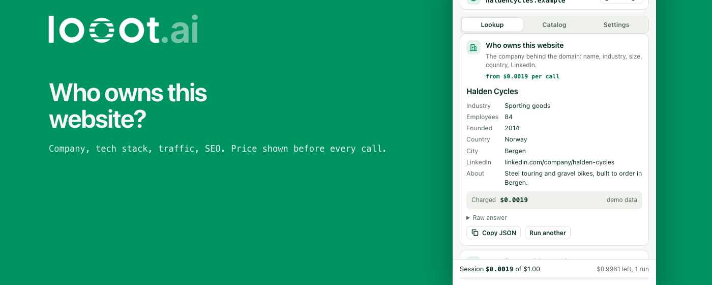

<p align="center">
  
</p>

# looot for Chrome

A Chrome side panel for [looot](https://looot.ai). Search 4,200+ data API endpoints and their prices for free, then run a lookup on the company whose site you have open: company profile, a work email, the tech stack. Every paid lookup shows its price and waits for a click.

looot gives one key and one prepaid balance for data APIs from 300+ providers. You pay per call, a failed call costs nothing, and there is no subscription. Docs: [docs.looot.ai](https://docs.looot.ai).

## What it does

| | Needs a token | looot job | Listed price on 2026-10-08 |
| --- | --- | --- | --- |
| Search the catalog | no | `GET /v1/public-catalog?q=` | free |
| Enrich this company | yes | `company.enrich` | from $0.0019 per call |
| Find work email, then verify it | yes | `people.email.find`, `people.email.verify` | from $0.003598 and $0.00145 per call |
| Tech stack | yes | `company.technographics` | free with one provider, others from $0.01 per result |

Prices are read live from the free catalog (`GET /v1/catalog/overview?depth=jobs`) each time the panel opens, so the table above will drift and the panel will not.

Spending rules, all enforced in the extension:

- A lookup shows its listed price and the most it can charge, and runs only after you click **Confirm and run**.
- Each call carries a cap (`fallback.maxCostUsd`, default $0.05) that holds across every provider looot tries.
- A session cap (default $0.50) stops new lookups when the session total could pass it. The total is always at the bottom of the panel.
- Each confirmed step has its own idempotency key, created when the price is shown. A double click or a retry cannot pay twice.
- After the run the panel shows `actualCost`.

## Install

From the Chrome Web Store: not published yet.

From source:

```bash
git clone https://github.com/loootai/looot-chrome && cd looot-chrome
npm ci
npm run build
```

Then open `chrome://extensions`, turn on Developer mode, click **Load unpacked** and pick the `dist` folder. Or download `looot-chrome-0.1.0.zip` from the [releases](https://github.com/loootai/looot-chrome/releases), unzip it and load that folder.

Click the looot icon in the toolbar to open the panel on the current tab. For paid lookups, paste a token from [looot.ai/settings](https://looot.ai/settings) (Agent tokens, with `catalog.read`, `runs.read`, `runs.execute`) into the Settings tab.

## Permissions

| Permission | Why |
| --- | --- |
| `sidePanel` | The interface is one side panel page. |
| `storage` | Your token and two limits in `chrome.storage.local`; the session total in `chrome.storage.session`. |
| `activeTab` | Reads the URL of the tab you click the icon on, to get the company domain. No page content, no injected script. |
| host `https://api.looot.ai/*` | The only server the extension calls. |

There are no content scripts and no remote code. The manifest's content security policy sets `connect-src https://api.looot.ai`.

## Privacy

- The token stays in this browser's local extension storage. It is not synced, not logged, and is sent only to `api.looot.ai` in the `Authorization` header.
- A domain, and the name you type for an email lookup, leave the browser only when you confirm that lookup.
- No analytics, no tracking, no third-party requests.

`test/manifest.test.ts` fails the build if a source file logs to the console, uses synced storage or names another host.

## Development

```bash
npm run typecheck   # tsc --noEmit
npm test            # vitest, fetch mocked, no network
npm run build       # esbuild -> dist/
npm run pack        # dist/ -> store/looot-chrome-<version>.zip
npm run check       # leak scan, typecheck, tests, build
```

Two browser scripts need a Playwright core and a Chromium binary that are not dependencies of this repo. Branded Chrome no longer accepts `--load-extension`, so use Chromium or Chrome for Testing:

```bash
export PW_CORE=/path/to/node_modules/playwright-core
export PW_CHROMIUM="/path/to/Chromium"
node scripts/load-check.mjs   # loads dist/ unpacked, checks the manifest, worker and panel
node scripts/shots.mjs        # renders the store screenshots and promo tiles
```

Layout: `src/lib` is the API client, price formatting, spend rules and answer readers (all unit tested). `src/panel` is the side panel UI in plain TypeScript and DOM. `src/background.ts` opens the panel on icon click. `public/` is copied to `dist/` as is.

## Store kit

`store/` holds what the Chrome Web Store asks for: the zip, five 1280x800 screenshots, the 440x280 and 1400x560 promo tiles, and `LISTING.md` with every text field, the permission justifications and the data-use answers.

The run answers in the screenshots are fixtures for a made-up company on a reserved `.example` domain. The catalog rows and prices in them are real, read from the live API when the images were rendered.

## License

MIT. See [LICENSE](LICENSE).
